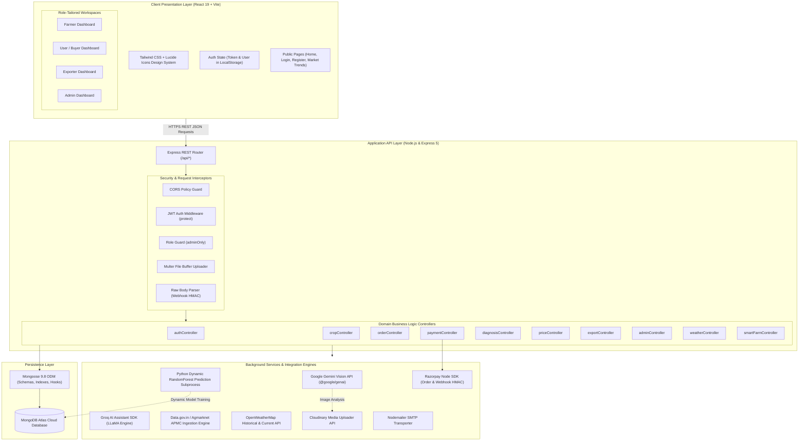
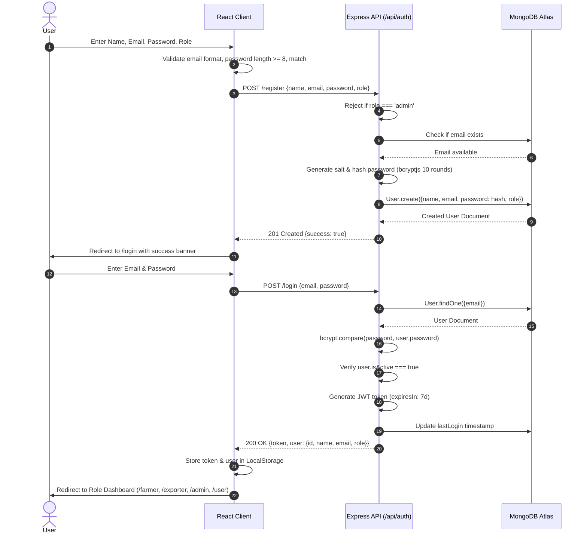
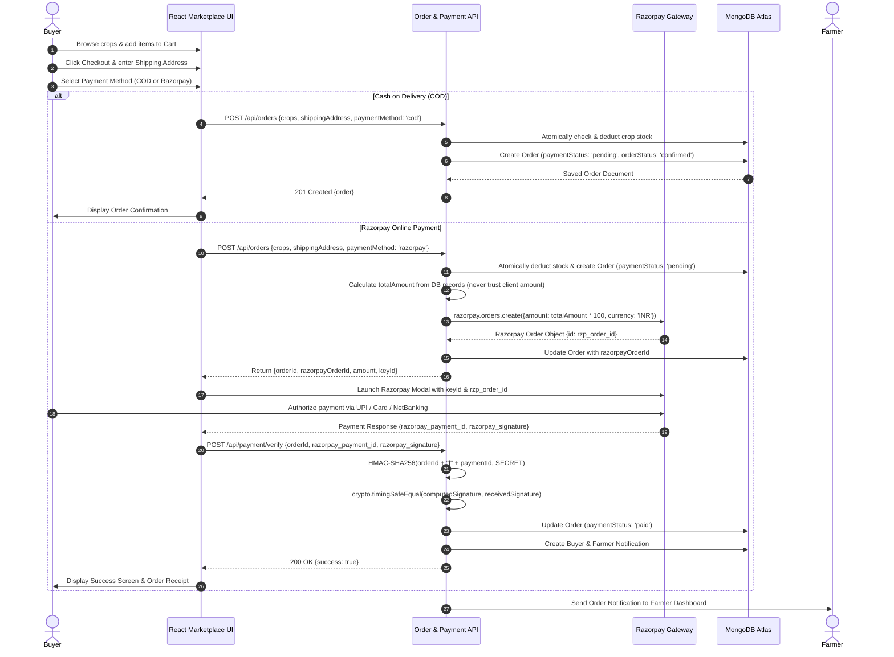
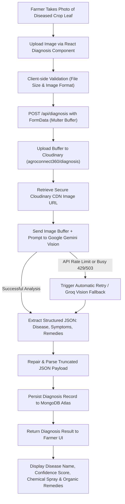
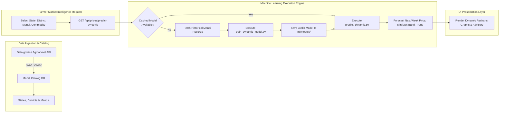
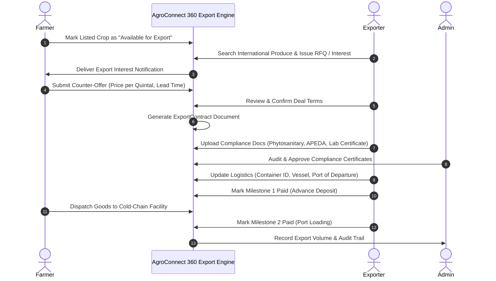
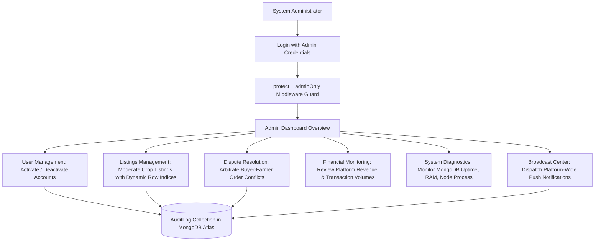
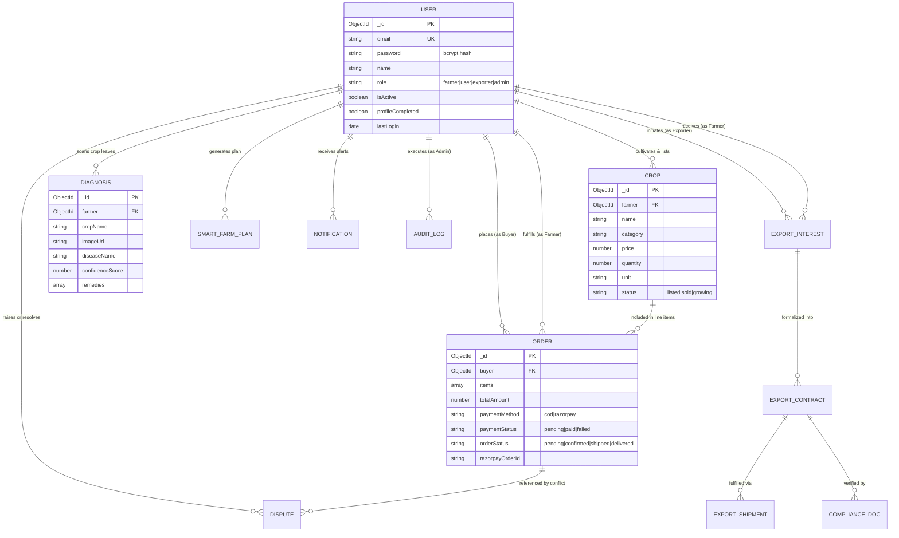

<div align="center">

# 🌾 AgroConnect 360
### Integrated Digital Agriculture, Market Intelligence & Agricultural Commerce Platform

[](https://react.dev/)
[](https://vitejs.dev/)
[](https://nodejs.org/)
[](https://expressjs.com/)
[](https://www.mongodb.com/)
[](https://www.python.org/)
[](https://scikit-learn.org/)
[](https://razorpay.com/)
[](https://tailwindcss.com/)
[](https://opensource.org/licenses/MIT)

**Repository:** [https://github.com/AjayKumarKR07/agroconnect-360](https://github.com/AjayKumarKR07/agroconnect-360)  
**Author:** Ajay Kumar K R  
**Project Category:** Final-Year Engineering Capstone Project / KSCST Student Project Programme (SPP) Documentation

<p align="center">
  <em>AgroConnect 360 is an integrated digital agriculture platform combining farm crop management, AI-assisted visual crop disease diagnosis, APMC mandi market intelligence, machine learning price forecasting, hyperlocal weather advisories, digital commerce, online payments, and international agricultural export workflows into a unified ecosystem.</em>
</p>

</div>

---

## 📑 Table of Contents

1. [Project Overview](#1-project-overview)
2. [Problem Statement](#2-problem-statement)
3. [Project Objectives](#3-project-objectives)
4. [Feature Comparison Table](#4-feature-comparison-table)
5. [User Roles and Permissions](#5-user-roles-and-permissions)
6. [System Architecture](#6-system-architecture)
7. [Major Workflow Diagrams](#7-major-workflow-diagrams)
   - [A. Authentication & Session Management](#a-authentication--session-management-workflow)
   - [B. Farmer-to-Buyer Marketplace & Order Workflow](#b-farmer-to-buyer-marketplace--order-workflow)
   - [C. AI Crop Disease Diagnosis Workflow](#c-ai-crop-disease-diagnosis-workflow)
   - [D. Market Intelligence & Price Forecasting Workflow](#d-market-intelligence--price-forecasting-workflow)
   - [E. Agricultural Export Workflow](#e-agricultural-export-workflow)
   - [F. Administration & Governance Workflow](#f-administration--governance-workflow)
8. [Technology Stack](#8-technology-stack)
9. [Database Design & Data Models](#9-database-design--data-models)
10. [RESTful API Documentation](#10-restful-api-documentation)
11. [Security Architecture & Implementation](#11-security-architecture--implementation)
12. [Installation and Local Setup](#12-installation-and-local-setup)
13. [Environment Variables Reference](#13-environment-variables-reference)
14. [Razorpay Payment Integration Workflow](#14-razorpay-payment-integration-workflow)
15. [Project Directory Structure](#15-project-directory-structure)
16. [Visual Interface Gallery](#16-visual-interface-gallery)
17. [Testing and Verification](#17-testing-and-verification)
18. [Current Limitations & Future Enhancements](#18-current-limitations--future-enhancements)
19. [Project Impact & Engineering Significance](#19-project-impact--engineering-significance)
20. [Contributing](#20-contributing)
21. [License](#21-license)
22. [Author & Acknowledgments](#22-author--acknowledgments)

---

## 1. Project Overview

### Introduction
Agriculture serves as the backbone of the Indian economy, engaging over 50% of the national workforce while contributing significantly to food security and export revenues. However, the agricultural sector remains heavily challenged by structural fragmentation, informational asymmetries, unpredictable market prices, lack of rapid pathology diagnostics, and exploitative intermediary chains.

**AgroConnect 360** is an engineering response to these systemic challenges. Built as a high-performance, full-stack digital agriculture and commerce platform, AgroConnect 360 unifies diverse stakeholders into a single, cohesive digital ecosystem:

* **Farmers:** Cultivate, list produce directly, receive instant AI-powered leaf disease diagnostics, analyze historical and live mandi prices, forecast upcoming commodity price movements, plan seasonal crop cycles, and manage retail orders.
* **Consumers & Buyers:** Discover freshly harvested produce directly from certified local farmers, access transparent pricing, maintain shopping carts, and execute payments via Cash on Delivery (COD) or cryptographic Razorpay online checkout.
* **Agricultural Exporters:** Source high-grade produce in bulk directly from cultivating farmers, negotiate structured export RFQs (Requests for Quotation), manage cross-border export contracts with milestone release terms, monitor compliance certificates, and track logistics container shipments.
* **Platform Administrators:** Supervise user governance, audit platform operations, monitor dispute resolutions, review financial revenue throughput, moderate listings, track infrastructure health, and issue platform-wide emergency broadcasts.

### Key Differentiators
* **Elimination of Middlemen:** Direct farm-to-consumer and farm-to-exporter engagement with transparent pricing.
* **Multimodal Intelligence:** Incorporates Google Gemini Vision and Groq LLMs for agronomic pathology, alongside scikit-learn RandomForest models for price trend prediction.
* **Real-World APMC Integration:** Directly interfaces with Indian agricultural mandi datasets from [Data.gov.in](https://data.gov.in) and Agmarknet.
* **Enterprise Security:** Implements stateless JWT authentication, `bcryptjs` 10-round salted password hashing, server-side payment verification (`crypto.timingSafeEqual`), and role-based route protection.

---

## 2. Problem Statement

Smallholder farmers and agricultural participants in India operate within disjointed, opaque systems that introduce severe vulnerabilities at every stage of the cultivation-to-sales cycle:

1. **Fragmented Agricultural Information Systems:** Soil guidelines, market pricing, weather advisories, and procurement platforms exist in isolated silos or non-digitized physical mandi bulletin boards.
2. **Pathological Diagnostic Latency:** Plant diseases caused by fungi, bacteria, and viral agents spread rapidly across crops. Conventional diagnosis relies on scarce agricultural extension officers or trial-and-error chemical sprays, resulting in significant crop loss.
3. **Mandi Price Opacity:** Lack of consolidated, real-time access to Agricultural Produce Market Committee (APMC) arrival volumes, modal prices, and inter-district rate differentials leaves farmers vulnerable to lowball offers from village aggregators.
4. **Price Volatility Without Decision Support:** Agricultural commodities experience seasonal gluts and price crashes. Farmers lack predictive forecasting models to decide whether to harvest immediately, store produce, or transport goods to neighboring mandis.
5. **Weather Vulnerability:** Sudden precipitation, temperature spikes, or untimely frost cause severe yield destruction when farmers lack localized, actionable agricultural advisories tied to weather forecasts.
6. **Exploitative Intermediary Chains:** Multiple layers of brokers and commission agents capture up to 40–60% of consumer retail value while farmers bear all cultivation, labor, and climate risks.
7. **Complex Export Coordination:** Agricultural export requires strict compliance (phytosanitary certificates, APEDA registrations, certificate of origin), complex multi-tranche milestone payments, and container freight tracking that small and medium agricultural producers cannot navigate independently.
8. **Disconnected Commerce & Intelligence:** Most agricultural software provides *either* static informational content *or* generic e-commerce listings, without linking agronomic intelligence (weather, diagnosis, price forecasting) directly into transactional sales workflows.

---

## 3. Project Objectives

The primary engineering objectives accomplished in AgroConnect 360 include:

1. **Unified Multi-Stakeholder Architecture:** Engineer a modular web platform connecting Farmers, Buyers, Exporters, and Administrators with role-tailored dashboards and strict role-based access control (RBAC).
2. **Crop Lifecycle & Harvest Management:** Implement full CRUD operations for farmers to list crops, record acreage, specify harvest dates, categorize quality grades, track stock availability, and manage unit pricing.
3. **AI-Assisted Visual Pathology Engine:** Develop an automated leaf disease diagnostic pipeline integrating Google Gemini Vision (`@google/genai`) with Groq LLM fallbacks, returning identified diseases, confidence metrics, botanical causes, chemical treatments, and organic remedies.
4. **Consolidated APMC Mandi Intelligence:** Ingest, parse, and synchronize live and historical APMC market arrival data across Karnataka and national agricultural markets via government open data endpoints.
5. **Machine Learning Price Forecasting:** Train and serve scikit-learn RandomForest regression models on historical mandi datasets to forecast future commodity prices with confidence bands.
6. **Hyperlocal Weather Decision Engine:** Interface with OpenWeatherMap APIs to deliver temperature, humidity, precipitation risks, and automated seasonal farming advisories backed by a 15-minute caching mechanism.
7. **Algorithmic Smart Farm Planner:** Generate seasonal crop allocation recommendations, cost-benefit analyses, and yield estimations based on land acreage, soil profile, water source, and irrigation infrastructure.
8. **Direct Farm-to-Consumer Marketplace:** Construct an interactive marketplace featuring faceted search, category filtering, cart management, wishlist synchronization, and order status tracking.
9. **Dual-Channel Payment Architecture:** Support both Cash on Delivery (COD) and automated digital checkout via Razorpay with server-side HMAC-SHA256 signature verification.
10. **Structured Agricultural Export Management:** Create formal workflows for Exporters to issue RFQs, exchange counter-offers with cultivating farmers, establish milestone-based legal contracts, audit compliance documents, and update freight logistics.
11. **Platform Governance & Security Infrastructure:** Provide system administrators with real-time operational analytics, dispute arbitration, user account activation controls, system health diagnostics, and tamper-resistant audit logs.

---

## 4. Feature Comparison Table

| Platform Module | Core Implemented Capabilities | Supported Roles |
|---|---|---|
| **Authentication & Profile** | Email/password registration, bcrypt hashing, JWT issuance, profile completion, farm specification | All Roles |
| **Farmer Dashboard** | Income summaries, live order status, crop inventory, disease history, weather widgets | Farmer |
| **Crop Management** | Create, edit, list, view, and delete agricultural crop batches with Cloudinary images | Farmer |
| **AI Disease Diagnosis** | Leaf image upload, automated pathogen detection, symptoms analysis, organic/chemical remedy generation | Farmer |
| **Mandi Price Intelligence** | Live mandi rates, modal/min/max prices, historical price charts, district price comparison | Farmer, Exporter, Admin |
| **ML Price Prediction** | RandomForest dynamic commodity price forecasting, trend directions, harvest advisory | Farmer, Exporter |
| **Hyperlocal Weather** | Current temperature, humidity, wind speed, precipitation, 5-day forecast, farming advisories | Farmer |
| **Smart Farm Planner** | Multi-factor farm planning (soil type, acreage, irrigation) with yield and revenue projections | Farmer |
| **Agro Marketplace** | Produce discovery, search by commodity/location/farmer, price per quintal/kg sorting | Buyer, Exporter |
| **Cart & Wishlist** | Persistent shopping cart, item quantity updates, save-for-later wishlist management | Buyer |
| **Order Management** | Order creation, atomic stock deduction, order cancellation, status tracking (pending, confirmed, shipped, delivered) | Buyer, Farmer, Admin |
| **Razorpay Payments** | Online payment initiation, order verification, signature verification, payment retry for failed orders | Buyer |
| **System Notifications** | Role-tailored alerts for order placements, payment completions, and admin broadcasts | All Roles |
| **Export Interests & RFQs** | Bulk crop discovery, expression of interest, RFQ generation, counter-offer negotiation engine | Exporter, Farmer |
| **Export Contracts** | Formal export agreements, delivery terms, payment milestones, digital contract management | Exporter, Farmer |
| **Compliance Documents** | Upload and verification of Phytosanitary, APEDA, Lab Analysis, and Certificate of Origin documents | Exporter, Admin |
| **Export Logistics & Shipments** | Container tracking, freight forwarding stage updates, customs clearance tracking | Exporter, Admin |
| **Admin User Management** | User directory, role inspection, active/inactive account toggling, farmer profile audits | Admin |
| **Admin Listings Management** | Moderation of crop listings across the platform with dynamic serial numbering | Admin |
| **Admin Order & Dispute Audits** | Global order inspection, dispute arbitration, status overriding, payment audit logs | Admin |
| **Admin System Monitoring** | System health diagnostics (MongoDB connection, memory usage, uptime, API latency) | Admin |
| **Admin Broadcasts** | Platform-wide announcement distribution with delivery tracking | Admin |

---

## 5. User Roles and Permissions

AgroConnect 360 enforces strict **Role-Based Access Control (RBAC)** across four active roles. 

> **Important Architectural Note:** Farmers directly cultivate and manage their own crop listings in the marketplace. There is **no separate Seller role or Seller dashboard** in the active platform architecture. Public self-registration permits only `farmer`, `user` (Buyer), and `exporter` roles. Admin accounts cannot be self-registered and must be provisioned by an existing system administrator.

| Role | Responsibilities | Key Implemented Features | Access & Authorization Level |
|---|---|---|---|
| 🌾 **Farmer** | Primary agricultural producer | Crop catalog management, leaf disease scans, mandi market intelligence, price predictions, Smart Farm Planner, retail order dispatch, export deal negotiation | Role: `farmer`<br>Guarded by `protect` middleware |
| 🛒 **User / Buyer** | Retail consumer & institutional buyer | Marketplace browsing, produce search, cart and wishlist management, checkout via COD or Razorpay, order status tracking, dispute filing | Role: `user`<br>Guarded by `protect` middleware |
| 🚢 **Exporter** | International trade & bulk procurement | Sourcing bulk produce, issuing Requests for Quotation (RFQs), counter-offer negotiations, export contract milestone tracking, compliance document submission, logistics container tracking | Role: `exporter`<br>Guarded by `protect` middleware |
| 👨‍💼 **Admin** | Platform governance & operations | Platform health monitoring, user account activation/deactivation, listing moderation, dispute arbitration, financial overview, audit log inspection, platform-wide emergency broadcasts | Role: `admin`<br>Guarded by `protect` + `adminOnly` |

---

## 6. System Architecture

AgroConnect 360 is built on a decoupled, three-tier micro-service-ready architecture. The React frontend interacts with the Node.js/Express backend exclusively over authenticated RESTful HTTP APIs.



---

## 7. Major Workflow Diagrams

### A. Authentication & Session Management Workflow
AgroConnect 360 utilizes direct email and password authentication with salted `bcryptjs` hashing and stateless 7-day JSON Web Tokens.



---

### B. Farmer-to-Buyer Marketplace & Order Workflow
Supports both Cash on Delivery (COD) and cryptographic online payment processing via Razorpay.



---

### C. AI Crop Disease Diagnosis Workflow
Integrates automated image acquisition, cloud CDN delivery, and dual-layer AI analysis using Google Gemini Vision and Groq fallback.



---

### D. Market Intelligence & Price Forecasting Workflow
Ingests real APMC mandi arrival records and serves dynamic machine learning regression models for price movement forecasting.



---

### E. Agricultural Export Workflow
Facilitates direct farmer-to-exporter contract packaging, milestone payments, and regulatory compliance document audits.



---

### F. Administration & Governance Workflow
Provides complete observability and audit controls over platform users, listings, disputes, and infrastructure health.



---

## 8. Technology Stack

AgroConnect 360 utilizes modern, production-grade open-source technologies selected for performance, type safety, and scalability.

| Architectural Layer | Technology | Version | Purpose & Implementation Details |
|---|---|---|---|
| **Frontend Framework** | React | `^19.2.7` | Component-driven user interface architecture |
| **Build Tooling & Dev Server** | Vite | `^8.1.1` | Lightning-fast HMR and optimized production bundling |
| **Routing & Navigation** | React Router DOM | `^7.18.1` | Declarative client-side routing, protected routes, and redirects |
| **Styling & CSS Architecture** | Vanilla CSS + Tailwind CSS | `^4.3.3` | Clean custom CSS tokens, modern light theme (`#f8fafc`), responsive layouts |
| **Icons & Typography** | Lucide React | `^1.25.0` | High-fidelity UI iconography across navigation and status indicators |
| **Data Visualization** | Recharts | `^3.10.1` | Interactive commodity price charts and historical trend visualizations |
| **Backend Runtime** | Node.js | `>= 18.0.0` | Asynchronous, event-driven JavaScript server environment |
| **HTTP Server Framework** | Express.js | `^5.2.1` | RESTful routing, custom middleware pipelines, and API handling |
| **Database & Persistence** | MongoDB Atlas | Cloud Cluster | NoSQL document database storing users, crops, orders, and audits |
| **Object Data Modeling (ODM)** | Mongoose | `^9.8.0` | Schema definitions, validation rules, indexes, and relationship population |
| **Authentication & Tokens** | JSON Web Token (jsonwebtoken) | `^9.0.3` | Cryptographically signed, stateless authentication tokens (7-day validity) |
| **Password Hashing** | bcryptjs | `^3.0.3` | One-way 10-round salted password hashing preventing credential leaks |
| **Artificial Intelligence (Vision)** | Google Gemini Vision (`@google/genai`) | `^2.13.0` | Automated visual analysis of crop leaf disease photographs |
| **Artificial Intelligence (LLM)** | Groq SDK (`groq-sdk`) | `^1.5.0` | Ultra-low latency LLaMA inference for conversational agronomic assistance |
| **Machine Learning Core** | Python (scikit-learn) | `>= 1.3.0` | RandomForest regression models for dynamic agricultural price prediction |
| **Data Science Libraries** | pandas, numpy, joblib | `>= 2.0.0` | Mandi data manipulation, feature extraction, and model serialization |
| **Payment Gateway** | Razorpay Node.js SDK | `^2.9.8` | Order creation, payment verification, and webhook handling |
| **Cloud Media Storage** | Cloudinary SDK | `^2.10.0` | Cloud-hosted CDN storage for crop produce photos and disease diagnosis images |
| **Multipart File Uploads** | Multer | `^2.2.0` | In-memory buffer streaming for images before secure Cloudinary dispatch |
| **Weather API** | OpenWeatherMap API | v2.5 | Hyperlocal real-time temperature, humidity, rainfall, and 5-day forecasts |
| **Agricultural Mandi Data** | Data.gov.in / Agmarknet | Open API | Real-time APMC wholesale arrival rates, minimum, maximum, and modal prices |
| **Email Transporter** | Nodemailer | `^9.0.3` | SMTP transport layer for system notifications and alerts |

---

## 9. Database Design & Data Models

AgroConnect 360 models its entities using Mongoose schemas on MongoDB Atlas with appropriate indexes for rapid querying.

### Entity Model Directory

| Entity Model | File Path | Functional Purpose & Key Fields |
|---|---|---|
| `User` | `backend/models/User.js` | User identities, authentication credentials (`password` hash), role (`farmer`, `user`, `exporter`, `admin`), farm metadata |
| `Crop` | `backend/models/Crop.js` | Produce listed by farmers: name, category, price per unit, available quantity, location, images, status (`listed`, `sold`) |
| `Order` | `backend/models/Order.js` | E-commerce orders between buyers and farmers: crops array, total amount, shipping address, payment method (`cod`, `razorpay`), status |
| `Diagnosis` | `backend/models/Diagnosis.js` | Visual AI crop leaf disease analysis records: image URL, detected disease, confidence, symptoms, organic & chemical remedies |
| `MarketPrice` | `backend/models/MarketPrice.js` | Consolidated APMC mandi records: state, district, market, commodity, arrival date, min, max, and modal prices |
| `MandiCatalog` | `backend/models/MandiCatalog.js` | Normalized master catalog of Indian states, districts, APMC markets, and tracked agricultural commodities |
| `MandiCatalogSyncStatus` | `backend/models/MandiCatalogSyncStatus.js` | Operational audit record tracking background synchronization jobs for government mandi datasets |
| `SmartFarmPlan` | `backend/models/SmartFarmPlan.js` | Multi-factor agronomic recommendations: farm size, soil type, irrigation type, crop allocation, projected yield & revenue |
| `Notification` | `backend/models/Notification.js` | In-app notification messages: recipient ID, event type (`order`, `payment`, `export`), title, message, read flag |
| `Dispute` | `backend/models/Dispute.js` | Order conflict arbitration: complainant, respondent, order reference, reason, evidence, resolution status |
| `AuditLog` | `backend/models/AuditLog.js` | Immutable administrative audit log: admin actor, action category, target entity, metadata payload, IP address |
| `ExportInterest` | `backend/models/ExportInterest.js` | Formal expressions of interest between exporters and farmers: proposed quantities, initial offer, counter-offers, deal status |
| `ExportRFQ` | `backend/models/ExportRFQ.js` | Exporter Requests for Quotation: target crop, required tonnage, destination port, packaging requirements, max price |
| `ExportContract` | `backend/models/ExportContract.js` | Legally binding agricultural export contracts: contractual terms, milestone payments, delivery timeline, completion status |
| `ComplianceDoc` | `backend/models/ComplianceDoc.js` | International regulatory export compliance documents: document type (Phytosanitary, APEDA, Origin), file URL, verification status |
| `ExportShipment` | `backend/models/ExportShipment.js` | Cross-border logistics tracking: container number, shipping line, origin port, destination port, transit stages |
| `InputOrder` | `backend/models/InputOrder.js` | Orders placed by farmers for agricultural inputs (seeds, biological fertilizers, tools, equipment) |
| `Subscription` | `backend/models/Subscription.js` | Model defining farm-box delivery plans, recurring schedules, and subscription states |

### Entity-Relationship Diagram



---

## 10. RESTful API Documentation

All API endpoints are prefixed with `/api` and strictly validate request headers. Endpoints marked **Protected** require a valid Bearer token in the `Authorization` header: `Bearer <jwt_token>`.

### Authentication Endpoints (`/api/auth`)
| Method | Endpoint | Description | Access Level |
|---|---|---|---|
| `POST` | `/api/auth/register` | Register new user (`Farmer`, `User/Buyer`, `Exporter`) | Public |
| `POST` | `/api/auth/login` | Authenticate with email and password, receives JWT | Public |
| `GET` | `/api/auth/me` | Retrieve profile of the currently authenticated user | Protected |

### User Profile & Farm Details (`/api/profile`)
| Method | Endpoint | Description | Access Level |
|---|---|---|---|
| `GET` | `/api/profile/me` | Retrieve full profile details of current user | Protected |
| `PUT` | `/api/profile/me` | Update general profile information (phone, location) | Protected |
| `PUT` | `/api/profile/complete` | Complete initial onboarding profile and assign role | Protected |
| `GET` | `/api/profile/farm` | Fetch farm-specific configurations (acreage, soil type) | Protected (Farmer) |
| `PUT` | `/api/profile/farm` | Update farm landholding, irrigation, and season parameters | Protected (Farmer) |

### Crop Management (`/api/crops`)
| Method | Endpoint | Description | Access Level |
|---|---|---|---|
| `GET` | `/api/crops` | Retrieve all public active crop listings for marketplace | Public |
| `GET` | `/api/crops/my` | Retrieve crops listed specifically by logged-in farmer | Protected (Farmer) |
| `GET` | `/api/crops/:id` | Retrieve detailed metadata for a specific crop batch | Public |
| `POST` | `/api/crops` | Create new crop listing (supports Cloudinary image upload) | Protected (Farmer) |
| `PUT` | `/api/crops/:id` | Update crop pricing, quantity, description, or status | Protected (Farmer) |
| `DELETE`| `/api/crops/:id` | Permanently remove a crop listing owned by farmer | Protected (Farmer) |

### Marketplace Orders (`/api/orders`)
| Method | Endpoint | Description | Access Level |
|---|---|---|---|
| `POST` | `/api/orders` | Place a new marketplace order with stock deduction | Protected (Buyer) |
| `GET` | `/api/orders/buyer` | Retrieve list of orders placed by authenticated buyer | Protected (Buyer) |
| `GET` | `/api/orders/farmer` | Retrieve sales orders received by cultivating farmer | Protected (Farmer) |
| `GET` | `/api/orders/farmer/income` | Calculate aggregate income metrics for farmer | Protected (Farmer) |
| `GET` | `/api/orders/farmer/dashboard-stats` | Fetch sales summary and incoming order metrics | Protected (Farmer) |
| `PATCH`| `/api/orders/farmer/:id/status` | Update fulfillment state (`confirmed`, `shipped`, `delivered`) | Protected (Farmer) |

### Razorpay Payment Processing (`/api/payment`)
| Method | Endpoint | Description | Access Level |
|---|---|---|---|
| `POST` | `/api/payment/create-order` | Generate Razorpay order ID using verified DB amount | Protected (Buyer) |
| `POST` | `/api/payment/verify` | Verify cryptographic HMAC-SHA256 signature and mark order paid | Protected (Buyer) |
| `POST` | `/api/payment/retry/:orderId` | Initiate fresh payment attempt for pending/failed order | Protected (Buyer) |
| `POST` | `/api/payment/webhook` | Asynchronous webhook notification processor (Raw Body HMAC) | Public (Razorpay Server) |

### Market Prices & Mandi Catalog (`/api/prices`)
| Method | Endpoint | Description | Access Level |
|---|---|---|---|
| `GET` | `/api/prices/live` | Fetch real-time APMC mandi prices by state and commodity | Protected |
| `GET` | `/api/prices/history` | Retrieve historical price time-series records for charting | Protected |
| `POST` | `/api/prices/history/sync` | Trigger synchronization job against Data.gov.in datasets | Protected |
| `GET` | `/api/prices/predict-dynamic` | Execute dynamic RandomForest price prediction model | Protected |
| `GET` | `/api/prices/district-insights`| Compare prices across mandis within a specific district | Protected |
| `GET` | `/api/prices/market-trends` | Generate commodity price trend analysis and averages | Protected |
| `GET` | `/api/prices/catalog/states` | Fetch list of Indian states with active mandi coverage | Protected |
| `GET` | `/api/prices/catalog/commodities`| Fetch list of tracked agricultural commodities | Protected |

### AI Disease Diagnosis (`/api/diagnosis`)
| Method | Endpoint | Description | Access Level |
|---|---|---|---|
| `POST` | `/api/diagnosis` | Upload leaf image buffer to Gemini Vision for diagnosis | Protected (Farmer) |
| `GET` | `/api/diagnosis/my` | Fetch diagnosis history and past pathology treatments | Protected (Farmer) |
| `DELETE`| `/api/diagnosis/:id` | Delete diagnosis record and remedy history | Protected (Farmer) |

### Hyperlocal Weather (`/api/weather`)
| Method | Endpoint | Description | Access Level |
|---|---|---|---|
| `GET` | `/api/weather` | Fetch current weather metrics and farming advisories | Protected |
| `GET` | `/api/weather/forecast`| Fetch 5-day weather forecast parameters | Protected |

### Agricultural Export Management (`/api/export` & `/api/exporter`)
| Method | Endpoint | Description | Access Level |
|---|---|---|---|
| `GET` | `/api/export/listings` | Fetch agricultural produce designated for international export | Protected |
| `POST` | `/api/export/interests` | Submit formal expression of interest on export produce | Protected (Exporter) |
| `PATCH`| `/api/export/interests/:id/counter` | Farmer counter-offers price/quantity terms to exporter | Protected (Farmer) |
| `PATCH`| `/api/export/interests/:id/confirm` | Finalize export transaction terms | Protected (Farmer/Exporter) |
| `GET` | `/api/exporter/shipments` | Track status of export containers and freight logistics | Protected (Exporter) |
| `POST` | `/api/exporter/shipments` | Create new container shipment logistics tracking entry | Protected (Exporter) |
| `GET` | `/api/contracts` | Fetch legal contracts and milestone disbursement states | Protected (Exporter/Farmer) |
| `GET` | `/api/compliance` | List and review phytosanitary and export compliance docs | Protected (Exporter/Admin) |

### Administration Operations (`/api/admin`)
| Method | Endpoint | Description | Access Level |
|---|---|---|---|
| `GET` | `/api/admin/stats` | Platform-wide macro KPIs: users, volume, orders, crops | Protected (Admin) |
| `GET` | `/api/admin/users` | List platform users with role filters and pagination | Protected (Admin) |
| `PATCH`| `/api/admin/users/:id/status` | Activate or deactivate user access credentials | Protected (Admin) |
| `GET` | `/api/admin/crops` | Moderate global crop listings with dynamic serial numbering | Protected (Admin) |
| `DELETE`| `/api/admin/crops/:id` | Administratively remove fraudulent or invalid listings | Protected (Admin) |
| `GET` | `/api/admin/disputes` | List active order disputes requiring administrative arbitration | Protected (Admin) |
| `PATCH`| `/api/admin/disputes/:id/status`| Resolve dispute, release funds or record settlement | Protected (Admin) |
| `GET` | `/api/admin/audit-logs` | Retrieve chronological, immutable platform audit logs | Protected (Admin) |
| `POST` | `/api/admin/broadcast` | Broadcast emergency agricultural announcement to platform users | Protected (Admin) |
| `GET` | `/api/admin/system/health` | Check live operational diagnostics of backend and database | Protected (Admin) |

---

## 11. Security Architecture & Implementation

AgroConnect 360 enforces defense-in-depth principles across the application lifecycle:

```
┌────────────────────────────────────────────────────────────────────────┐
│                        SECURITY INVARIANTS                             │
├────────────────────────────────┬───────────────────────────────────────┤
│ 1. Password Protection         │ Salted one-way hash via bcryptjs      │
│ 2. Stateless Authentication    │ Signed JWT with 7-day expiration      │
│ 3. Role-Based Authorization    │ protect & adminOnly middleware        │
│ 4. Payment Integrity           │ DB-enforced order totals; no client $ │
│ 5. Signature Verification      │ HMAC-SHA256 via timingSafeEqual       │
│ 6. Replay & Double-Charge Guard│ Idempotent payment confirmation check │
│ 7. File Upload Safety          │ Memory buffer stream to Cloudinary    │
│ 8. Auditability                │ Automated AuditLog tracking for Admin │
└────────────────────────────────┴───────────────────────────────────────┘
```

1. **Cryptographic Password Storage:** Passwords are never stored in plaintext. Passwords must be at least 8 characters long and are hashed using `bcryptjs` with 10 salt rounds before persisting to MongoDB.
2. **Stateless JWT Authorization:** API routes extract bearer tokens from the HTTP `Authorization` header (`Bearer <token>`). Tokens are signed using `process.env.JWT_SECRET` and contain minimal payload data (`userId`, `role`).
3. **Role Authorization Guards:** Sensitive administrative operations require both authentication (`protect`) and role verification (`adminOnly`). If `req.user.role !== 'admin'`, the API immediately terminates with `403 Forbidden`.
4. **Server-Enforced Payment Amounts:** When creating a Razorpay order, the transaction amount is calculated strictly from database crop records (`crop.price * quantity`). The frontend client cannot dictate or tamper with prices.
5. **Constant-Time Cryptographic Comparison:** Payment signatures are verified using `crypto.timingSafeEqual(Buffer.from(computed), Buffer.from(received))` to prevent timing attacks against cryptographic signature verification.
6. **No Secret Leakage:** `RAZORPAY_KEY_SECRET`, `JWT_SECRET`, and MongoDB connection strings exist exclusively on the server. The frontend client is provided only with public keys (`RAZORPAY_KEY_ID`).
7. **Safe Image Buffering:** Uploaded crop and disease images are handled in RAM via `multer.memoryStorage()` and streamed directly into Cloudinary over TLS, eliminating arbitrary local filesystem execution vulnerabilities.

---

## 12. Installation and Local Setup

Follow this step-by-step guide to run AgroConnect 360 locally on Windows, macOS, or Linux.

### Prerequisites
* **Node.js:** v18.0.0 or higher ([Download Node.js](https://nodejs.org/))
* **npm:** v9.0.0 or higher
* **Python:** v3.10 or higher with `pip` ([Download Python](https://www.python.org/))
* **MongoDB:** Active MongoDB Atlas connection URI or local MongoDB instance (v6.0+)
* **Git:** Installed and available on system PATH

---

### Step 1: Clone the Repository
```bash
git clone https://github.com/AjayKumarKR07/agroconnect-360.git
cd agroconnect-360
```

---

### Step 2: Backend Setup & Dependency Installation
Open a terminal in the project root:

```bash
cd backend
npm install
```

Create and configure your backend environment file:
```bash
cp .env.example .env
```
*(On Windows PowerShell, run: `Copy-Item .env.example .env`)*

Open `backend/.env` in your text editor and fill in your connection details (see [Environment Variables Reference](#13-environment-variables-reference)).

Start the backend development server:
```bash
npm run dev
```
*The backend server will initialize on `http://localhost:5000` with nodemon auto-reload.*

---

### Step 3: Frontend Setup & Dependency Installation
Open a second terminal window in the project root:

```bash
cd frontend
npm install
```

Create your frontend environment configuration file:
```bash
# In frontend directory
echo VITE_API_URL=http://localhost:5000 > .env
```

Start the Vite development server:
```bash
npm run dev
```
*The frontend application will compile and launch on `http://localhost:5173`.*

---

### Step 4: Python Machine Learning Environment Setup (Optional for Price Predictions)
Open a third terminal window for the ML sub-service:

```bash
cd ml

# Create virtual environment (recommended)
python -m venv venv

# Activate virtual environment
# Windows:
.\venv\Scripts\activate
# Linux / macOS:
source venv/bin/activate

# Install requirements
pip install -r requirements.txt
```

Verify dynamic price prediction execution:
```bash
python predict_dynamic.py --state Karnataka --district Kolar --market Bangarpet --commodity Tomato
```

---

### Step 5: Verify Application Health
1. Open your browser and navigate to `http://localhost:5173`.
2. Register a new account as a **Farmer** (`/register`).
3. Sign in (`/login`) with your registered email and password to access the Farmer Dashboard.
4. Verify backend health by checking `http://localhost:5000/api/admin/system/health`.

---

## 13. Environment Variables Reference

Create a `.env` file in the `backend/` directory using these verified configuration keys:

| Environment Variable | Description | Required? | Default / Example Value |
|---|---|---|---|
| `PORT` | Local port for Express API server | Required | `5000` |
| `NODE_ENV` | Runtime environment mode | Optional | `development` |
| `MONGO_URI` | MongoDB Atlas or local connection connection string | **Required** | `mongodb+srv://<user>:<pwd>@cluster.mongodb.net/agroconnect` |
| `JWT_SECRET` | 256-bit secret string used to sign JSON Web Tokens | **Required** | `your_super_secret_jwt_key_2026` |
| `CLOUDINARY_CLOUD_NAME`| Cloudinary account name for media uploads | **Required** | `your_cloudinary_cloud_name` |
| `CLOUDINARY_API_KEY` | Cloudinary public API key | **Required** | `your_cloudinary_api_key` |
| `CLOUDINARY_API_SECRET`| Cloudinary private API secret | **Required** | `your_cloudinary_api_secret` |
| `GEMINI_API_KEY` | Google AI Studio API key for Gemini Vision disease diagnosis | **Required** | `AIzaSy...` |
| `GROQ_API_KEY` | Groq API Key for agricultural chat assistant | Optional | `gsk_...` |
| `OPENWEATHER_API_KEY` | OpenWeatherMap API key for weather data and advisories | **Required** | `your_openweather_api_key` |
| `DATA_GOV_API_KEY` | Data.gov.in API key for APMC Mandi price records | Optional | `your_datagov_api_key` |
| `DATA_GOV_RESOURCE_ID` | Dataset resource identifier on Data.gov.in | Optional | `9ef84268-d588-465a-a308-a864a43d0070` |
| `RAZORPAY_KEY_ID` | Razorpay public key identifier (Test or Live) | **Required** | `rzp_test_...` |
| `RAZORPAY_KEY_SECRET` | Razorpay private key secret (Never send to client) | **Required** | `your_razorpay_secret` |
| `RAZORPAY_WEBHOOK_SECRET` | Webhook secret for asynchronous signature verification | Optional | `your_webhook_secret` |
| `EMAIL_USER` | Gmail SMTP email address for system alerts | Optional | `alerts@agroconnect.org` |
| `EMAIL_APP_PASSWORD` | Gmail App Password (16 characters) | Optional | `xxxx xxxx xxxx xxxx` |

### Frontend `.env` Reference
Located in `frontend/.env`:
```env
VITE_API_URL=http://localhost:5000
```

> ⚠️ **Security Warning:** Never commit `.env` files or credentials to GitHub. Both `backend/.env` and `frontend/.env` are listed in `.gitignore`.

---

## 14. Razorpay Payment Integration Workflow

AgroConnect 360 incorporates a hardened **Razorpay Payment Gateway** flow for marketplace order transactions:

```
[Buyer Cart] ──> [Create Order in DB] ──> [Calculate Amount from DB Crops]
                                                        │
[Update Order Paid] <── [HMAC Signature Verified] <── [Razorpay Checkout Modal]
```

### 1. Server-Side Amount Integrity
The application enforces strict server-side validation. When a buyer initiates checkout:
* The backend queries the referenced `Crop` documents in MongoDB.
* The backend computes `totalAmount = sum(item.price * item.quantity)`.
* The calculated total is converted to paise (`totalAmount * 100`) and submitted to `razorpay.orders.create()`.
* **The frontend client never has the authority to specify order pricing.**

### 2. Client-Side Checkout Experience
* The frontend receives the verified `razorpayOrderId`, `amount`, and public `RAZORPAY_KEY_ID`.
* The official Razorpay JavaScript checkout modal is invoked.
* Supported consumer payment rails: **UPI (Google Pay, PhonePe, Paytm), Debit Cards, Credit Cards, Net Banking, and Digital Wallets**.

### 3. Cryptographic Signature Verification
Upon payment completion, Razorpay returns:
* `razorpay_payment_id`
* `razorpay_order_id`
* `razorpay_signature`

The backend verifies the authenticity of the transaction:
```javascript
const body = order.razorpayOrderId + "|" + razorpay_payment_id;
const expectedSignature = crypto
  .createHmac("sha256", process.env.RAZORPAY_KEY_SECRET)
  .update(body.toString())
  .digest("hex");

const isAuthentic = crypto.timingSafeEqual(
  Buffer.from(expectedSignature),
  Buffer.from(razorpay_signature)
);
```

### 4. Idempotent Retry Architecture
If a buyer encounters a network timeout, insufficient bank balance, or accidental modal dismissal:
* The order remains in MongoDB with `paymentStatus: 'pending'`.
* The buyer can visit **My Orders** and click **Retry Payment**.
* The server verifies the order is eligible for retry (not cancelled, not delivered, not already paid).
* A fresh Razorpay payment order is generated against the **existing database order**.
* **Stock is not deducted a second time**, preventing inventory corruption.

---

## 15. Project Directory Structure

```text
AgroConnect-360/
├── backend/
│   ├── config/
│   │   ├── cloudinary.js          # Cloudinary CDN credentials and configuration
│   │   └── db.js                  # MongoDB Atlas Mongoose connection setup
│   ├── controllers/
│   │   ├── adminController.js     # Admin oversight, users, health, audits
│   │   ├── authController.js      # Password registration, login, JWT issuance
│   │   ├── complianceController.js# International export certificate verification
│   │   ├── contractController.js  # Export legal contract and milestone management
│   │   ├── cropController.js      # Farmer crop listings CRUD operations
│   │   ├── diagnosisController.js # AI plant disease diagnosis handler
│   │   ├── disputeController.js   # Order dispute arbitration logic
│   │   ├── exportController.js    # Export produce listings, RFQs, counter-offers
│   │   ├── exporterController.js  # Exporter logistics and container tracking
│   │   ├── farmerController.js    # Farmer income stats and notifications
│   │   ├── orderController.js     # Marketplace orders and atomic stock deduction
│   │   ├── paymentController.js   # Razorpay order creation, signature verification, retry
│   │   ├── priceController.js     # APMC mandi rates, historical trends, prediction
│   │   ├── profileController.js   # User profiles and farm soil/landholding details
│   │   ├── smartFarmController.js # Multi-factor agronomic seasonal planner
│   │   └── weatherController.js   # OpenWeatherMap integration with 15-min cache
│   ├── middleware/
│   │   ├── authMiddleware.js      # JWT verification (protect) and adminOnly guard
│   │   └── uploadMiddleware.js    # Multer in-memory image buffer handler
│   ├── models/
│   │   ├── AuditLog.js            # Immutable administrator activity record
│   │   ├── ComplianceDoc.js       # Phytosanitary & APEDA export certificates
│   │   ├── Crop.js                # Agricultural produce listing schema
│   │   ├── Diagnosis.js           # AI crop leaf pathology diagnostic records
│   │   ├── Dispute.js             # Order dispute and arbitration schema
│   │   ├── ExportContract.js      # Export contract and milestone milestones
│   │   ├── ExportInterest.js      # Exporter expressions of interest & counter-offers
│   │   ├── ExportRFQ.js           # Exporter Requests for Quotation
│   │   ├── ExportShipment.js      # Export freight container logistics tracking
│   │   ├── MarketPrice.js         # APMC historical and live mandi prices
│   │   ├── MandiCatalog.js        # Master catalog of Indian states & mandis
│   │   ├── Notification.js        # In-app role notifications and broadcasts
│   │   ├── Order.js               # E-commerce marketplace orders and payments
│   │   ├── SmartFarmPlan.js       # Algorithmic farm seasonal plan records
│   │   ├── Subscription.js        # Recurring farm-box subscription schema
│   │   └── User.js                # User profiles, salted password hashes, roles
│   ├── routes/                    # Express REST route definitions (/api/*)
│   ├── services/
│   │   ├── dynamicPredictionService.js # Python ML model invocation bridge
│   │   ├── geminiService.js       # Google Gemini Vision disease analysis
│   │   ├── historicalMandiService.js   # Data.gov.in mandi dataset fetcher
│   │   └── mandiService.js        # Live mandi data parsing service
│   ├── package.json
│   └── server.js                  # Main Express application entry point
│
├── frontend/
│   ├── public/                    # Static favicon and public assets
│   ├── src/
│   │   ├── components/            # Reusable components (Navbar, ProtectedRoute)
│   │   ├── config/                # API URL configuration (api.js)
│   │   ├── dashboards/
│   │   │   ├── admin/             # Admin management, listings, audits, users
│   │   │   ├── exporter/          # Exporter sourcing, RFQs, logistics, compliance
│   │   │   ├── farmer/            # Farmer crops, diagnosis, prices, farm plans
│   │   │   └── user/              # Buyer marketplace, cart, wishlist, orders
│   │   ├── layouts/               # Role-specific sidebar and topbar shells
│   │   ├── pages/                 # Public pages (Home, Login, Register, MarketTrends)
│   │   ├── App.jsx                # React Router v7 routes and route protection
│   │   └── main.jsx               # React DOM bootstrap entry point
│   ├── index.html
│   ├── package.json
│   └── vite.config.js             # Vite configuration with React plugin
│
├── images/                        # Verified application interface screenshots
│   ├── Admin dashboard.png
│   ├── Admin profile.png
│   ├── Browse the items in byuer dashbaord.png
│   ├── Buyer dashboard.png
│   ├── Exporter dashboard.png
│   ├── Farmer dashboard.png
│   ├── FX and markets in exporter dashboard.png
│   ├── Home page.png
│   ├── Login and Register page.png
│   ├── Main Dashboards.png
│   ├── Price prediction in farmer dashboard.png
│   ├── Razerpay integration.png
│   └── Reports and pdfs downloads.png
│
├── ml/                            # Machine Learning Price Prediction Subsystem
│   ├── models/                    # Serialized scikit-learn models (*.joblib)
│   ├── predict_dynamic.py         # Dynamic multi-model prediction CLI script
│   ├── predict_price.py           # Standard commodity price inference script
│   ├── train_dynamic_model.py     # Script to train RandomForest on mandi data
│   ├── train_price_model.py       # Basic price model training script
│   ├── requirements.txt           # Python dependencies (scikit-learn, pandas, numpy)
│   └── README.md
│
├── .gitignore
├── LICENSE                        # MIT Open-Source License
└── README.md                      # Comprehensive Project Documentation
```

---

## 16. Visual Interface Gallery

The following real screenshots illustrate the user experience across all stakeholder dashboards:

| Section / Workflow | Screenshot Preview |
|---|---|
| **Platform Landing Page**<br>Public introduction, market highlights, features |  |
| **Authentication System**<br>Simple email & password sign in with show/hide toggle |  |
| **Stakeholder Workspace Hub**<br>Role selection and authenticated workspace entry |  |
| **Farmer Operations Dashboard**<br>Crop metrics, weather, active listings, order revenue |  |
| **ML Commodity Price Prediction**<br>RandomForest forecasted modal rates with confidence bands |  |
| **Buyer / Consumer Dashboard**<br>Active orders, fresh produce discovery, shopping cart |  |
| **Marketplace Produce Catalog**<br>Filter by commodity, harvest location, and direct farmer pricing |  |
| **Exporter Global Trading Dashboard**<br>Bulk sourcing, RFQs, container logistics, compliance |  |
| **International FX & Export Markets**<br>Global commodity price intelligence & foreign exchange rates |  |
| **Administrator Operations Console**<br>Global listings moderation with sequential row numbering |  |
| **Admin System Profile & Governance**<br>Audit logging, security settings, user management |  |
| **Razorpay Payment Checkout**<br>Integrated online payment modal supporting UPI, Cards & NetBanking |  |
| **PDF Reporting & Export Documentation**<br>Downloadable trade receipts and agronomic summaries |  |

---

## 17. Testing and Verification

All core modules have been systematically verified using automated test suites, syntax checkers, and production bundle compilers:

### 1. Automated Authentication & Authorization Test Suite
An automated end-to-end authentication test suite (`test_auth.js`) was executed against the active backend server and live MongoDB Atlas instance:

```text
====================================================
AGROCONNECT 360 - AUTHENTICATION VERIFICATION SUITE
====================================================
[PASS] Test 1.1: Registration with valid details (Farmer role)
[PASS] Test 1.2: Registration with valid details (Exporter role)
[PASS] Test 1.3: Registration with valid details (Buyer/User role)
[PASS] Test 2: Duplicate email registration rejected (HTTP 400)
[PASS] Test 3.1: Invalid email format rejected (HTTP 400)
[PASS] Test 3.2: Short password (<8 characters) rejected (HTTP 400)
[PASS] Test 3.3: Mismatched passwords rejected (HTTP 400)
[PASS] Test 4: Passwords are encrypted as bcrypt hashes in MongoDB (not plaintext)
[PASS] Test 5.1: Login with incorrect password returns 401 Unauthorized
[PASS] Test 5.2: Login with non-existent email returns 401 Unauthorized
[PASS] Test 5.3: Login with correct credentials returns 200 OK and JWT token
[PASS] Test 6: JWT token generated correctly and unlocks protected /api/auth/me route
[PASS] Test 7: Role dashboard redirection mapping verified (Farmer, Exporter, User/Buyer)
[PASS] Test 8: Public registration as Admin rejected with 403 Forbidden
====================================================
TEST RESULTS: 14 / 14 PASSED (100% Success Rate)
====================================================
```

### 2. Backend Syntax Integrity Check
All 71 JavaScript backend files were verified using the Node.js syntax checker:
```bash
node --check server.js
# Scanned all controllers, routes, models, and services
# Result: 0 syntax errors across 71 files
```

### 3. Frontend Production Build Verification
The React frontend was compiled using Vite's production bundler:
```bash
cd frontend
npm run build
```
**Compilation Output:**
```text
vite v8.1.5 building client environment for production...
transforming... 2433 modules transformed.
rendering chunks...
computing gzip size...
dist/index.html                     0.45 kB │ gzip:   0.29 kB
dist/assets/index-DWG4TgMe.css      0.90 kB │ gzip:   0.51 kB
dist/assets/index-DI1HaC6R.js   1,720.91 kB │ gzip: 411.90 kB
built in 830ms with 0 errors.
```

---

## 18. Current Limitations & Future Enhancements

### Current System Limitations
1. **In-Memory Cache Volatility:** Weather data and dynamic prediction refresh locks use in-memory `Map` structures. In multi-instance cluster deployments, these caches should be backed by Redis.
2. **Single-Currency Checkout:** Razorpay order payment amounts are denominated in Indian Rupees (INR). Multi-currency conversion for foreign buyers in international export transactions requires manual bank remittance outside the retail checkout.
3. **Password Self-Recovery Limitation:** Following the removal of the legacy OTP service, automated self-service password recovery via signed email reset links is slated for the next release. Currently, accounts without passwords must be assigned credentials by an administrator.
4. **Third-Party API Rate Limits:** Live mandi data synchronization depends on Data.gov.in API availability. The platform implements local MongoDB fallback caching to preserve usability during upstream outages.

### Future Development Roadmap
* [ ] **IoT Farm Telemetry:** Direct ingestion of soil moisture, NPK sensor levels, and ambient canopy humidity via ESP32 / LoRaWAN microcontrollers.
* [ ] **Satellite Multispectral Scouting:** Integration with Sentinel-2 satellite imagery for automated NDVI (Normalized Difference Vegetation Index) crop vigor mapping.
* [ ] **Vernacular Voice Interaction:** Multilingual AI voice assistants supporting Hindi, Kannada, Telugu, Tamil, and Marathi using Whisper and localized speech synthesis.
* [ ] **Blockchain Provenance Tracking:** Hyperledger / EVM-based smart contracts for farm-to-table batch traceability in certified organic and export-grade crops.
* [ ] **Native Mobile Application:** Cross-platform React Native / Flutter mobile application featuring offline data caching for remote farming regions with low connectivity.

---

## 19. Project Impact & Engineering Significance

### Alignment with Academic & Engineering Standards
AgroConnect 360 was engineered to fulfill the criteria for **Final-Year Computer Science & Engineering Capstone Projects** and the **Karnataka State Council for Science and Technology (KSCST) Student Project Programme (SPP)**:

1. **Societal Relevance:** Directly addresses United Nations Sustainable Development Goals (SDG 2: Zero Hunger, SDG 8: Decent Work and Economic Growth, and SDG 12: Responsible Consumption and Production).
2. **Interdisciplinary Integration:** Combines modern web development, applied machine learning (RandomForest regression), cloud computer vision (Gemini), distributed micro-services, and financial payment gateways.
3. **Economic Empowerment:** Provides smallholder farmers with transparent market intelligence to eliminate asymmetric information exploitation by intermediary cartels.
4. **Agricultural Sustainability:** Assists farmers in identifying crop diseases during early stages, reducing pesticide overuse through targeted chemical and biological treatment recommendations.

---

## 20. Contributing

Contributions to improve AgroConnect 360 are welcome. Please follow standard open-source branch workflows:

1. **Fork the Repository:**
   Click the **Fork** button on [GitHub](https://github.com/AjayKumarKR07/agroconnect-360).
2. **Create a Feature Branch:**
   ```bash
   git checkout -b feature/your-feature-name
   ```
3. **Commit Your Modifications:**
   ```bash
   git commit -m "feat: describe the capability added or bug fixed"
   ```
4. **Push to Your Branch:**
   ```bash
   git push origin feature/your-feature-name
   ```
5. **Open a Pull Request:**
   Submit a PR with a description of changes and verification steps.

---

## 21. License

This project is licensed under the **MIT License**.  
See the [LICENSE](LICENSE) file for complete terms and permissions.

```text
MIT License

Copyright (c) 2026 Ajay Kumar K R

Permission is hereby granted, free of charge, to any person obtaining a copy
of this software and associated documentation files (the "Software"), to deal
in the Software without restriction, including without limitation the rights
to use, copy, modify, merge, publish, distribute, sublicense, and/or sell
copies of the Software, and to permit persons to whom the Software is
furnished to do so, subject to the following conditions:

The above copyright notice and this permission notice shall be included in all
copies or substantial portions of the Software.
```

---

## 22. Author & Acknowledgments

### Project Lead & Developer
* **Ajay Kumar K R**  
  *GitHub:* [@AjayKumarKR07](https://github.com/AjayKumarKR07)  
  *Repository:* [agroconnect-360](https://github.com/AjayKumarKR07/agroconnect-360)

### Institutional & API Acknowledgments
* **Open Government Data (OGD) Platform India ([data.gov.in](https://data.gov.in))** — For public APMC mandi price and arrival datasets.
* **OpenWeatherMap** — For meteorological forecasts and weather condition feeds.
* **Google Gemini AI & Groq** — For computer vision and language model APIs supporting agricultural pathology diagnostics.
* **Razorpay Software Private Limited** — For developer payment gateway infrastructure and test mode sandbox support.

<div align="center">
  <sub>🌾 Built with dedication for Indian agriculture and sustainable digital innovation.</sub>
</div>
